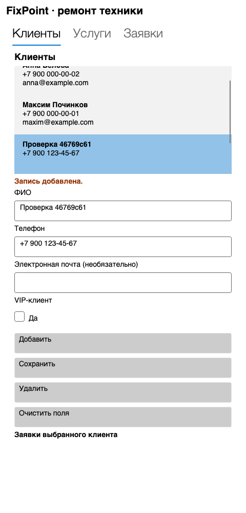
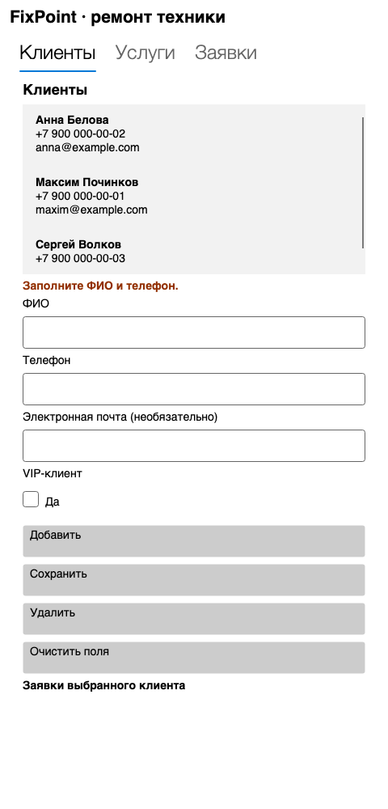
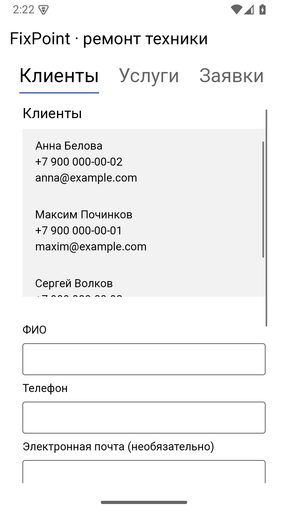
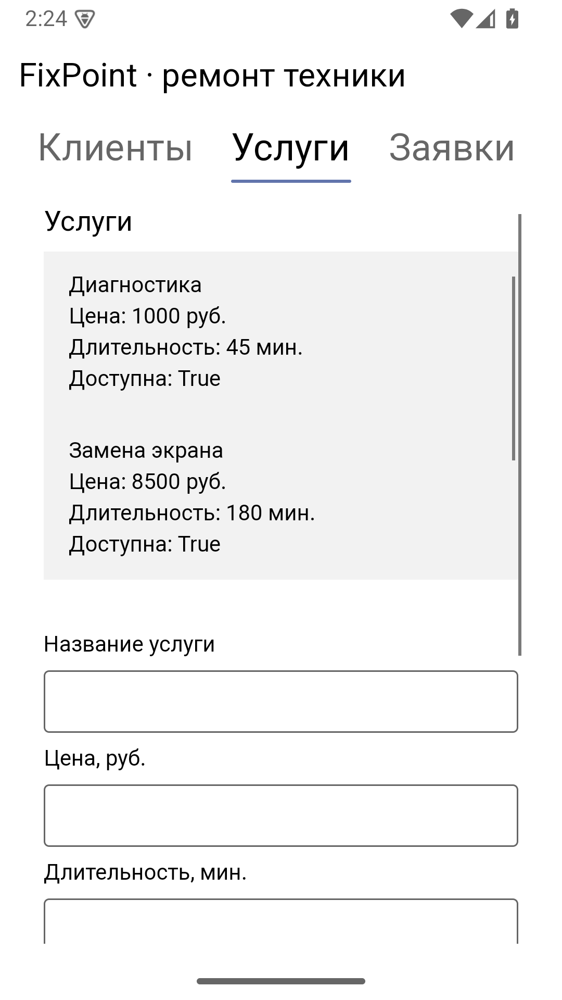
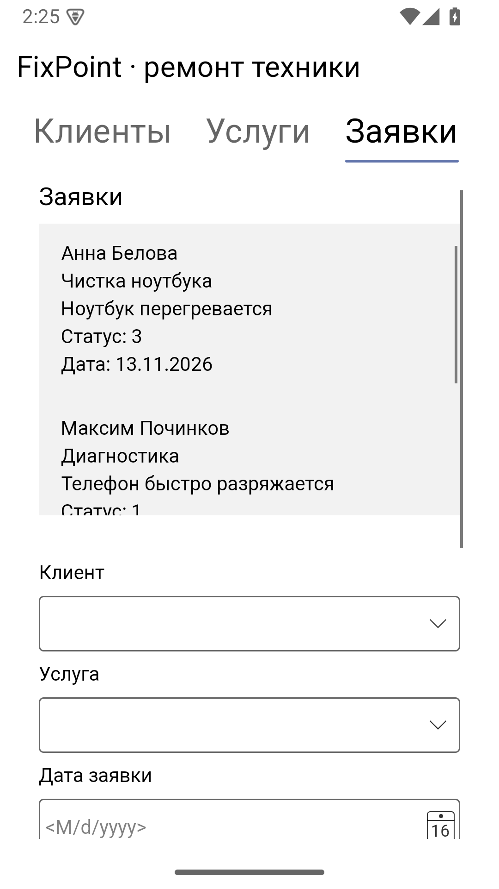
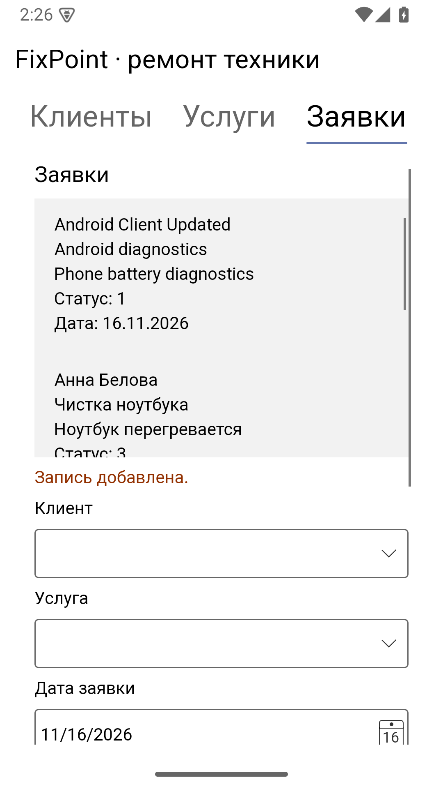
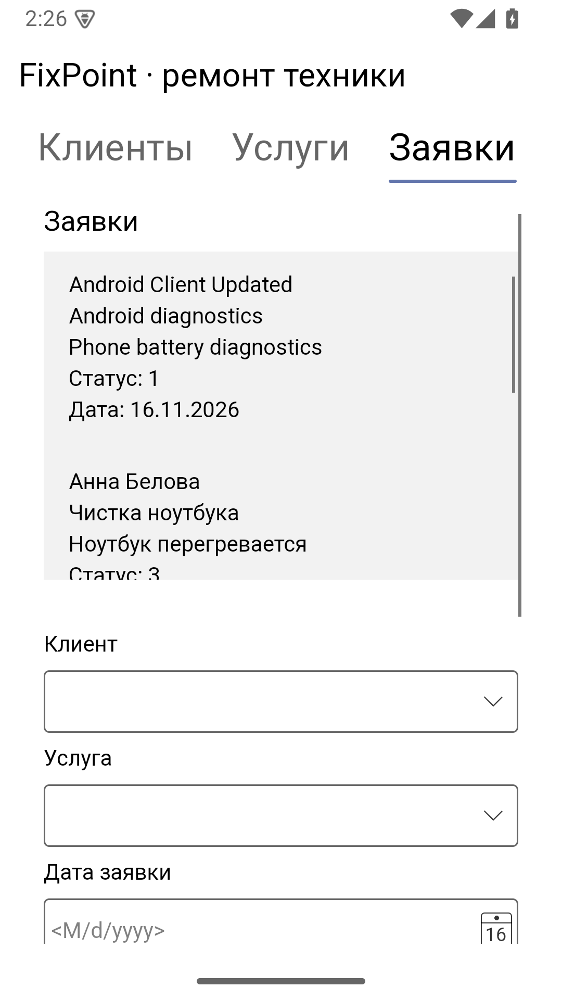
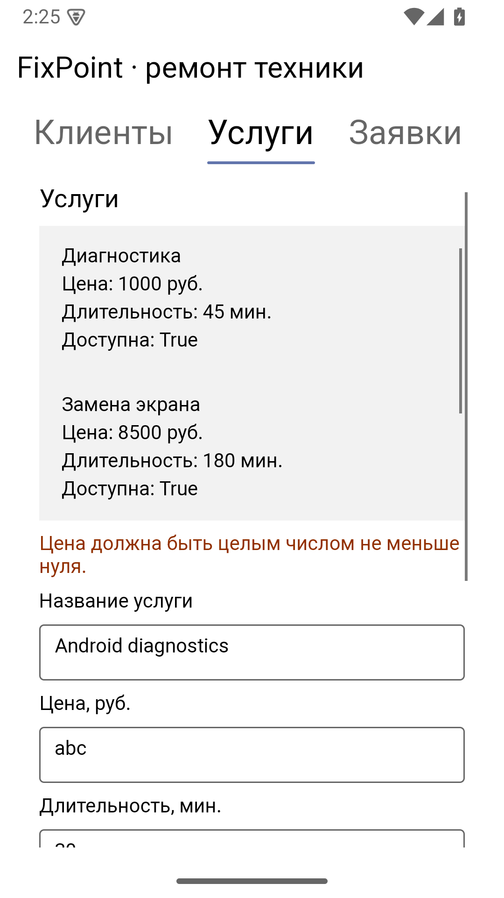
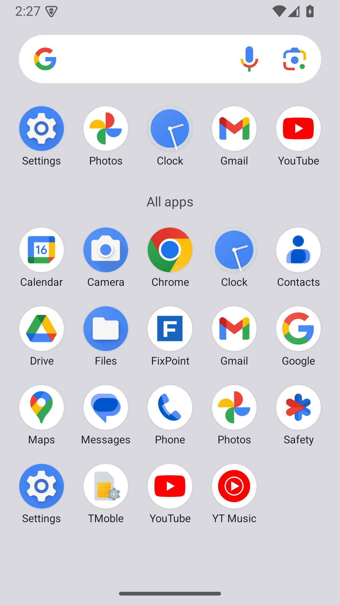

# FixPoint — учёт ремонта техники

Общий интерфейс Avalonia находится в `MyApp/MainView.axaml`, слой данных — в `../DZ2/MyApp.Data`. Схема и модели ДЗ 2 сохранены.

## ДЗ 4

Три вкладки: клиенты, услуги и заявки. Каждая позволяет добавить, изменить и удалить выбранную запись. Выбор строки заполняет форму. В заявке клиент и услуга выбираются по именам через ComboBox, сохраняются только их Id. Обязательные поля, числа, дата и выбор связанных записей проверяются до SaveChanges. Сообщения отображаются на той же вкладке. Все списки и ComboBox обновляются после записи.

При удалении клиента удаляются все его заявки. При удалении услуги также удаляются заявки на эту услугу: обязательные внешние ключи используют каскадное удаление EF Core/SQLite. Остальные клиенты и услуги сохраняются. Удаление заявки не удаляет клиента или услугу.

```sh
dotnet run --project MyApp.Desktop
dotnet run --project MyApp.Checks -- screens/dz4
```

Проверки запускают настоящий MainView с SQLite через Avalonia.Headless и проверяют обработчики кнопок, валидацию, обновление списков, повторную загрузку и каскадное удаление. Тестовые записи с уникальным префиксом удаляются после выполнения. Существующие записи не удаляются.

### Снимки отрисованного интерфейса

PNG получены через Avalonia.Headless/Skia при выполнении приложения (это не снимки Windows или Android). SVG из раннего ДЗ 3 — только макеты.




Проверено на macOS: сборка Desktop и автоматические проверки. Запуск на Windows пока не проверен.

## ДЗ 5 — Android

`MyApp.Android` содержит только платформенный запуск, манифест и иконку. Название под иконкой — **FixPoint**. `App` использует `ISingleViewApplicationLifetime`, чтобы тот же `MainView` работал на Android. Путь SQLite остаётся из ДЗ 2 (`LocalApplicationData/myapp.db`).

Поля и кнопки расположены вертикально, минимальная высота — 40, вкладки прокручиваются, высота ListBox ограничена. На ширине 360 проверены все три вкладки и тот же сценарий работы с SQLite. Снимки `screens/dz5-layout` — проверка общей разметки через Avalonia.Headless, не снимки эмулятора.

Для Android нужны .NET 10 с workload `android`, Android SDK и JDK 17 или новее (сборка проверена с JDK 17):

```sh
dotnet workload install android
dotnet build MyApp.Android -t:InstallAndroidDependencies -p:AcceptAndroidSdkLicenses=True
dotnet build MyApp.Android -t:Run
```

Проверено на эмуляторе Android 15 (API 35, arm64, 360 dp):
- приложение устанавливается из самостоятельного APK и создаёт базу при первом запуске;
- на всех трёх вкладках вводятся данные с открывающейся экранной клавиатурой, работают прокрутка и календарь;
- добавлены клиент, услуга и заявка, клиент изменён, заявка удалена через интерфейс;
- неверная цена `abc` выдаёт сообщение, запись не добавляется;
- после `am force-stop` и повторного запуска клиент и заявка сохраняются;
- имя FixPoint отображается под иконкой в меню приложений;
- после завершения SQLite-база прочитана вместе с WAL: изменённый клиент и услуга на месте, удалённой заявки нет.

Настольная сборка и проверки общего MainView на macOS проходят. Запуск непосредственно на Windows не проверен.

### Скриншоты из эмулятора









APK собирается для arm64 с включёнными .NET-сборками и может устанавливаться отдельно. Для Android 16 сборщик предупреждает о выравнивании страницы libSkiaSharp.so; совместимость с устройствами с 16-КБ страницами пока не подтверждена.
