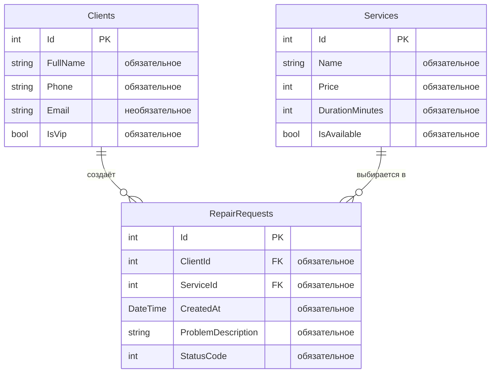

# FixPoint — сервис записи в мастерскую

Небольшое приложение для мастерской по ремонту смартфонов и ноутбуков. Клиент оставляет заявку, выбирает услугу и видит статус ремонта. Мастерская использует систему, чтобы хранить клиентов, перечень услуг и заявки на ремонт.

## Автор

Максим Починков, группа 9/3-РПО-24/1.

## О проекте

**Тема:** клиенты, услуги и записи в мастерскую.

**Заведение:** сервисный центр «FixPoint».

Клиенты обращаются в мастерскую с заявками на ремонт техники. В каждой заявке указаны клиент, выбранная услуга, дата обращения, описание неисправности и стоимость. Сотрудник мастерской может быстро найти историю обращений клиента и список заявок по услуге. «FixPoint» отличается тем, что хранит прозрачный статус каждой заявки и не требует повторно вводить данные постоянного клиента.

## Схема базы данных

## Таблицы

### Clients

Хранит данные людей, которые обращаются в сервисный центр. Поля `FullName`, `Phone` и `IsVip` позволяют идентифицировать клиента и выделить постоянных клиентов.

| Поле | Тип | Обязательное | Описание |
| --- | --- | --- | --- |
| `Id` | `int` | да | Первичный ключ клиента. |
| `FullName` | `string` | да | Имя и фамилия клиента. |
| `Phone` | `string` | да | Контактный номер телефона. |
| `Email` | `string` | нет | Электронная почта, если клиент её указал. |
| `IsVip` | `bool` | да | Признак постоянного клиента. |

### Services

Справочник услуг мастерской: диагностика, замена экрана, чистка ноутбука и другие работы.

| Поле | Тип | Обязательное | Описание |
| --- | --- | --- | --- |
| `Id` | `int` | да | Первичный ключ услуги. |
| `Name` | `string` | да | Название услуги. |
| `Price` | `int` | да | Стоимость услуги в рублях. |
| `DurationMinutes` | `int` | да | Плановая длительность работы в минутах. |
| `IsAvailable` | `bool` | да | Можно ли сейчас заказать услугу. |

### RepairRequests

Связующая таблица заявок. Она соединяет клиента с услугой и хранит данные конкретного обращения.

| Поле | Тип | Обязательное | Описание |
| --- | --- | --- | --- |
| `Id` | `int` | да | Первичный ключ заявки. |
| `ClientId` | `int` | да | Внешний ключ на `Clients.Id`. |
| `ServiceId` | `int` | да | Внешний ключ на `Services.Id`. |
| `CreatedAt` | `DateTime` | да | Дата и время создания заявки. |
| `ProblemDescription` | `string` | да | Описание неисправности со слов клиента. |
| `StatusCode` | `int` | да | Код статуса: принята, в работе, готова или закрыта. |

## Связи

Один клиент может создать много заявок: `RepairRequests.ClientId` ссылается на `Clients.Id`. Одна услуга может встречаться во многих заявках: `RepairRequests.ServiceId` ссылается на `Services.Id`. Поэтому `Clients` и `Services` связаны отношением «многие ко многим» через `RepairRequests`. В связующей таблице два обязательных внешних ключа и собственные поля заявки.
